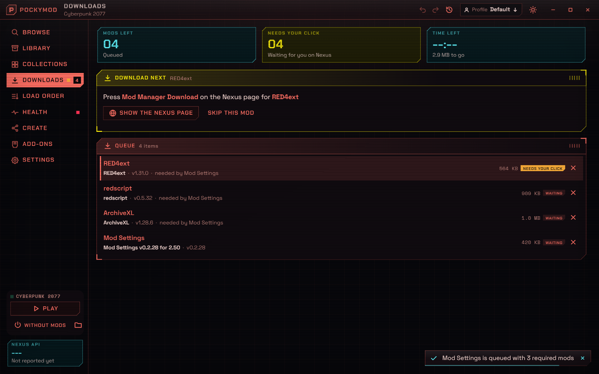
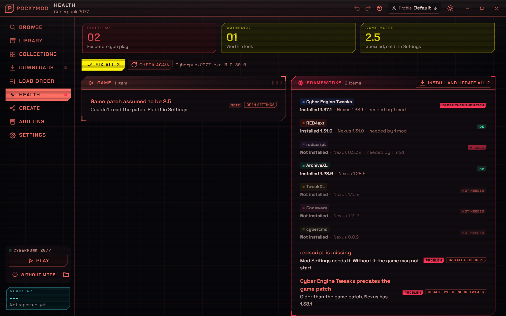
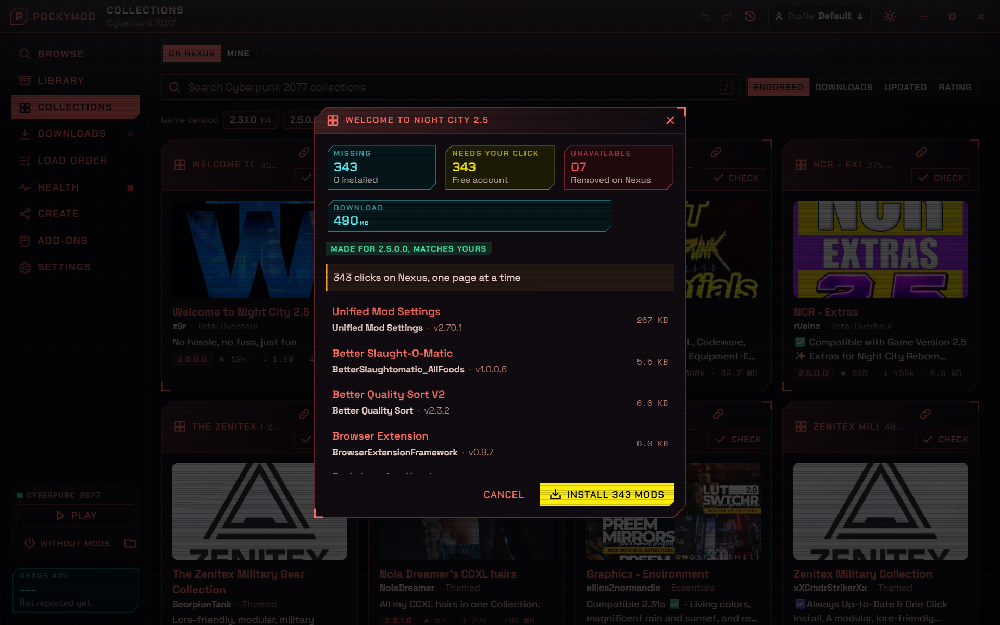
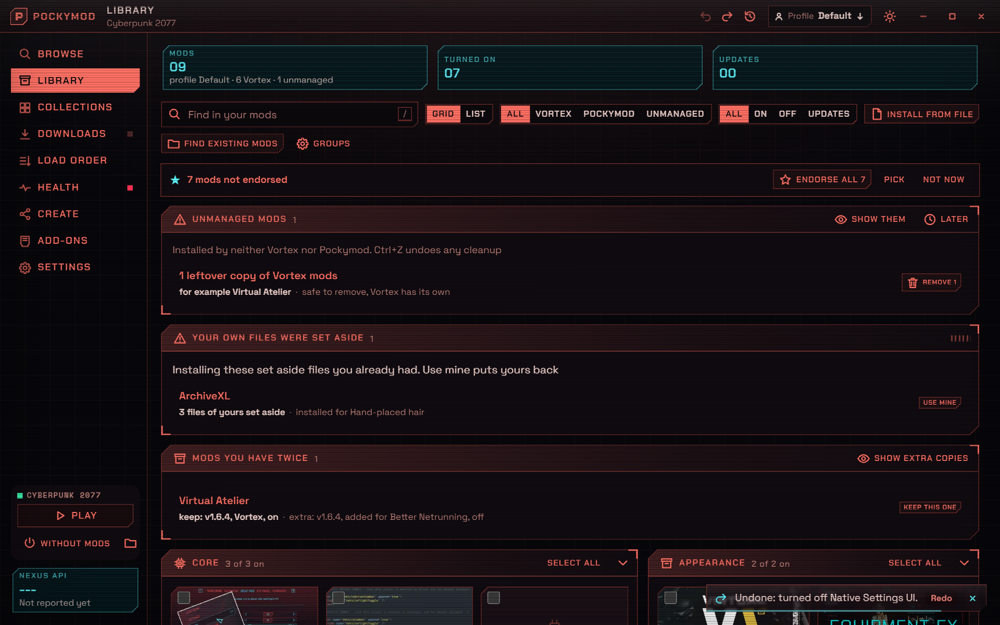

# Pockymod

A mod manager for Cyberpunk 2077 on Windows. You browse and install mods from Nexus Mods without leaving the app, with filters Nexus doesn't have, like "updated since your game patch". It also picks up the mods you already have, including ones Vortex installed.

**[Download the latest installer](https://github.com/imanimal/Pockymod/releases/latest)** for Windows 10 or 11 (64-bit). It's an alpha.

The installer isn't signed yet, so Windows may say it protected your PC. Click More info, then Run anyway. You'll need a Nexus Mods account.

## Installing

Press Install and whatever the mod needs comes with it. Here Mod Settings brought in redscript, RED4ext and ArchiveXL. Premium accounts download straight away. On a free account the app shows each mod's Nexus page, you press Mod Manager Download, and it moves on to the next one.

## After a game patch

Health checks your frameworks against the game version. When Cyber Engine Tweaks is older than the patch or a requirement is missing, it says what will break and fixes it with one key, or everything at once with Fix all.

## Collections

Before you install a collection you can check it against what you have: how many mods are missing, how many clicks it takes on a free account, which ones Nexus removed and whether it was made for your game version.

## Mods you already have

Vortex's mods come in with their profiles and stay in Vortex's format. If an install would replace files you put in yourself, they're set aside instead of deleted, and Use mine puts them back. Ctrl+Z undoes any change to your mods.

## Making things for it

There are short guides for [themes](docs/themes.md), [extensions](docs/extensions.md) and [publishing your own mods](docs/creators.md). To build the app yourself, see [docs/development.md](docs/development.md).
