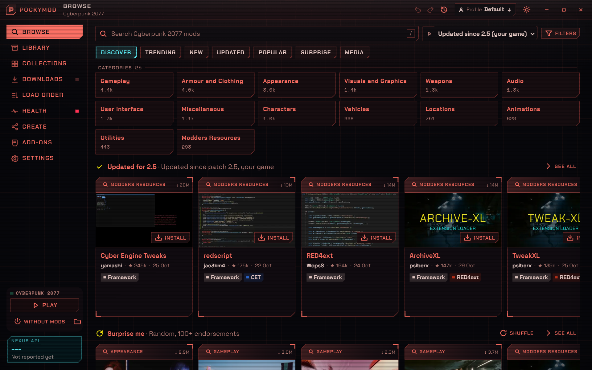

# Pockymod

A mod manager for Cyberpunk 2077 on Windows. You browse and install mods from Nexus Mods without leaving the app, and it picks up the mods you already have, including ones Vortex installed. After a game patch it shows what needs updating, and you can undo any change to your mods.

**[Download the latest installer](https://github.com/imanimal/pocket-mods/releases/latest)** for Windows 10 or 11 (64-bit). It's an alpha.

The installer isn't signed yet, so Windows may say it protected your PC. Click More info, then Run anyway.

You'll need a Nexus Mods account. With a free account you click the download button on each mod's Nexus page and the app takes it from there. Premium downloads start on their own.

## Making things for it

There are short guides for [themes](docs/themes.md), [extensions](docs/extensions.md) and [publishing your own mods](docs/creators.md). To build the app yourself, see [docs/development.md](docs/development.md).
