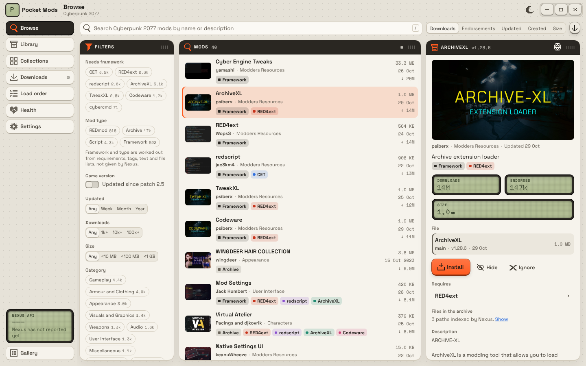

# Milestone 3: Browser



## Summary

- **Search** on name and description (`nameStemmed` and `description` MATCHES, plus a name wildcard), sorted by relevance while there is text.
- **Sort**: relevance, downloads, endorsements, updated, created, size; ascending or descending.
- **Filters with counts**:
  - Category and tag chips with counts from the same `mods()` response (`facetsData`). Categories are ORed, tags ANDed; shift-click a tag to exclude it.
  - Updated (week, month, year), downloads (1k+, 10k+, 100k+), size (under 10 MB, 100 MB, 1 GB), adult content.
  - **Cyberpunk-aware, derived here**: required framework (CET, RED4ext, redscript, ArchiveXL, TweakXL, Codeware, cybercmd) and mod type (REDmod, archive, script, framework). Nexus has no such fields, so the filter sent to Nexus matches tags and text, and the counts for every option come from **one** extra request with an alias per option, cached for 30 minutes.
  - **Game version**: "Updated since patch X" (from the patch table, Settings will pick the installed one in milestone 5).
  - **Local**: hide or ignore a mod; show hidden mods; downloaded / not downloaded. The "downloaded" view is a lookup by ID of what this PC has downloaded, in one request.
- **Cards** show thumbnail, name, author, category, type tag, framework chips, size, updated date and downloads. The framework chips come from requirement links fetched inside the page query (no request per card), then tags and words.
- **Detail**: one `mod()` + `modFiles()` request when a mod is opened, cached and refreshed when the card's `updatedAt` moves. Shows picture, summary, LCDs for downloads, endorsements and size, the file picker, requirements (click to open), the archive's file list when Nexus has indexed it (it then decides the mod type), the description as plain text, Hide and Ignore, and the orange Install key (wired in milestone 4).
- **Cache** (`pocket-core::db`, SQLite): pages keyed on filter, sort and offset with a 10-minute TTL; derived counts 30 minutes; mod details by `updatedAt`; file lists forever. Old pages are pruned at start.
- **Classifier** (`cyberpunk/classify.rs`) and **install layout** (`cyberpunk/layout.rs`): the rules that turn an archive's file list into a mod type and target paths. The browser uses them on Nexus's indexed file lists; milestone 4 uses the same rules to install.

## Run

```
npm run tauri dev        # live Nexus
npm run dev              # demo data in a browser
cargo test -p pocket-core
cargo test -p pocket-core --test live -- --ignored   # live search, cache, hide filter and detail
cargo run -p pocket-core --example demo_fixture -- src/lib/demo   # refresh the demo data
npm test                 # description text cleanup
```

## Test

1. Type "vehicle": results switch to relevance. Clear the text: back to downloads.
2. Press CET, then ArchiveXL: both stay latched and the counts on the other chips change to "with these too".
3. Pick a category and a tag; shift-click another tag to exclude it (it shows as "− name").
4. Turn on "Updated since patch 2.5". Only mods updated after 22 Oct 2026 remain.
5. Open a mod: files, requirements and LCDs show. Click a requirement to open it. Hide the mod: it leaves the list; "Show hidden mods" brings it back dimmed.
6. Page with the arrow keys under the list; the LCD shows the page. Repeat a search within 10 minutes: the band says "cached" and no request is made.

## Checked here

- Live integration test against Nexus (anonymous): search, facets, derived counts, cache hit, hide filter, ArchiveXL detail with its indexed file list.
- 36 unit tests in pocket-core (filter building, classification, layout, cache, patches) and 3 front-end tests.
- Screenshot above from the built UI with the demo backend.

## Not verified

- Not run inside WebView2. Thumbnails load from `staticdelivery.nexusmods.com`, which the CSP allows; untested in Tauri.
- Derived filters are heuristics. Text matching misses mods that need a framework without saying so, and the "archive" type filter is broad (it matches the word "archive"). The chips on each card are better, because they use requirement links.
- "Updated since patch" assumes a mod updated after a patch works with it. Patch dates are from memory, except 2.5 (from the spec), and are marked UNVERIFIED in `cyberpunk/patches.rs`.
- Signed-in extras on the detail view (endorsed, tracked) are not shown yet; they come with milestone 4's account calls.
