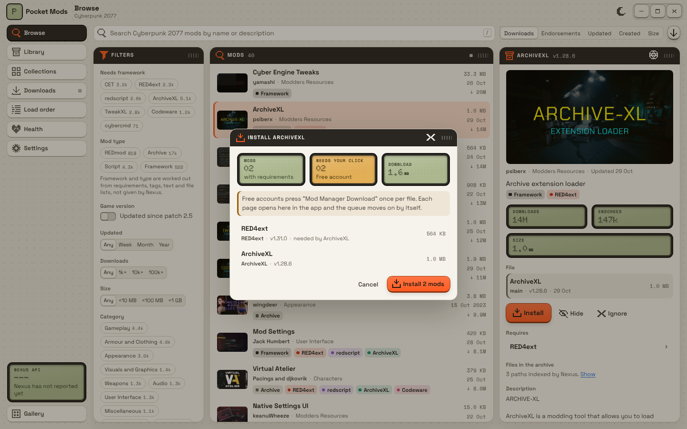
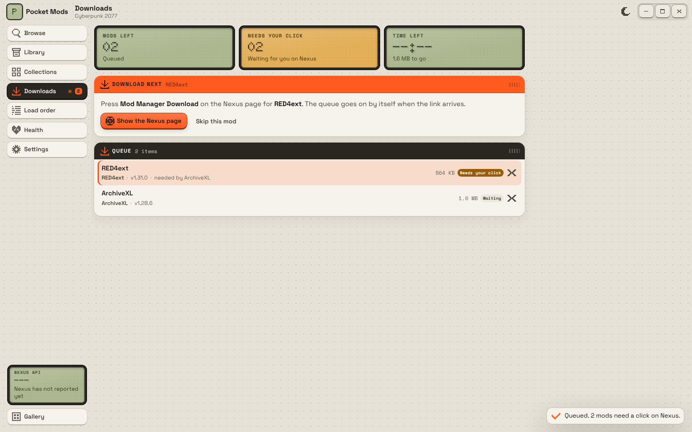

# Milestone 4: Install core

| Install plan | Queue waiting on a click |
|---|---|
|  |  |

## Summary

- **Install key → plan.** Install on a mod first resolves its Nexus requirements that are not installed (frameworks already in the game folder count as installed), and shows the cost before anything downloads: how many mods, how many need a click on Nexus, and the download size.
- **Free accounts.** The queue opens each file's Nexus page in an app window (WebView2, label `nexus`), never the system browser. When the user presses "Mod Manager Download", the window's navigation to the `nxm://` link is caught before it leaves the app, the link is matched to the queued file, and the queue downloads, installs and opens the next page by itself. Picking another file of the same mod on the page is accepted too.
- **Premium accounts.** The queue asks v1 for direct links and runs without stopping, dependencies included. If Nexus says the account is not Premium after all, it falls back to clicks.
- **Manual-only files** (not .zip, .7z or .rar) open their page in the app and are not installed automatically.
- **nxm:// handler.** Settings shows who handles `nxm://` now (Pocket Mods, Vortex, Mod Organizer 2, another app) and takes it back with one key. Registered per user under `HKCU\Software\Classes\nxm`, no admin rights. A second start of the app (Windows opening a link) hands the link to the running window through the single-instance plugin and exits.
- **Downloads** stream to `<library>\downloads` as `.part`, hashed with MD5 on the way, and are renamed when complete. A file already downloaded is not downloaded again.
- **Extraction**: .zip, .7z and .rar (bundled UnRAR source). Entry paths are checked: no absolute paths, drive letters or `..`.
- **Placement** follows `cyberpunk/layout.rs` (milestone 3): archives to `archive\pc\mod`, REDmods to `mods\<name>`, redscript to `r6\scripts`, TweakXL to `r6\tweaks`, CET Lua to `bin\x64\plugins\cyber_engine_tweaks\mods`, RED4ext plugins and anything already laid out keep their paths. Wrapper folders are stripped. Files with no known place stop the install for a review ("Install the rest").
- **Hard-link deploy** with a manifest (`deployed_files` table, plus `.pocket-manifest.json` in each staging folder):
  - mod storage defaults to `<game drive>:\PocketMods`, same drive as the game, outside Program Files;
  - hard links only; when the library is on another drive or links fail, nothing is written and the user is asked before copying (Settings has a standing "copy fallback" switch with a warning);
  - a file no mod owns (a game file) is moved to `<library>\backup` and put back on uninstall;
  - a path another mod owns is a conflict: nothing is written until the user picks "Take them over", and the other mod gets its file back when this one is removed;
  - a failed deploy undoes what it wrote;
  - writes refused under Program Files give a plain message with the fix (move the game to another Steam library, or grant Modify rights).
- **Uninstall** removes only files that are still the mod's (same hard link, or same size for copies), leaves files changed by hand, restores backups and previous owners, and removes the mod's empty folders but never the game's.
- **Updates**: installing another file of an installed mod replaces the old one; if the new deploy fails, the old one is redeployed.
- **Library** screen: installed mods with type, frameworks and deployed file count, Deploy for staged ones, Uninstall, archives downloaded but not installed, and Install from file for archives from elsewhere.

## Run

```
npm run tauri dev
cargo test -p pocket-core       # 54 tests, including deploy, install and queue
```

## Test (on Windows, with a Nexus account)

1. Settings: choose the Cyberpunk 2077 folder. The library defaults to `X:\PocketMods` on the game's drive and shows "Same drive: hard links".
2. Settings, nxm:// links: if Vortex has it, press "Use Pocket Mods". Click "Mod Manager Download" in a web browser: the running app takes the link.
3. Browse, pick a mod that needs ArchiveXL, press Install. The plan lists ArchiveXL and RED4ext if missing, with the click count.
4. Free account: Install. The Nexus window opens on the first file; press Mod Manager Download. The Downloads LCDs go green, the rail's LED blinks, and the next page opens by itself.
5. Premium account: Install runs to the end without a page.
6. In the game folder, check a deployed file with `fsutil hardlink list <file>`: it lists the staging copy too.
7. Library: uninstall. The mod's files go, `archive\pc\mod` stays, a replaced game file comes back.
8. Install two mods that ship the same `.archive`: the second shows "Files already in use". Take them over, then uninstall the second: the first mod's file is back.

## Checked here

- Unit tests on Linux with real files: hard links, backup and restore, conflict hand-back, hand-edited files left alone, rollback, update replacing an older file, unknown-file review, zip and 7z extraction with traversal entries.
- The queue state machine (free, Premium, manual-only, links for other files or mods, retry).
- `cargo check` of the core and the whole Tauri app for `x86_64-pc-windows-gnu` (registry, single instance, WebView2 window code compile).
- The whole flow in a browser with the demo backend (plan dialog, queue, library), screenshots above.

## Not verified

- **Nothing was downloaded or installed from Nexus**: there is no API key on the build machine. Needs a local run.
- `download_link.json` with `key` and `expires` for free accounts, and the 403 message for non-Premium accounts (UNVERIFIED, from the v1 docs and Vortex).
- The `?tab=files&file_id=…&nmm=1` page URL that should open the "Mod Manager Download" step for one file (UNVERIFIED, as Vortex uses it), and that the Nexus site's button navigates the WebView2 window to `nxm://` in a way `on_navigation` sees.
- Signing in to Nexus inside the app window (cookies persist in the WebView2 profile; untested).
- RAR extraction (the UnRAR source compiles; no RAR file could be made here to test it).
- Hard links, permissions and Program Files behaviour on NTFS (tested on Linux only); the same-drive check on Windows compares drive letters, so a library in a mounted folder is decided by the link attempt.
- The REDmod deploy step after installing a REDmod is milestone 5; until then the queue notes that it is needed.
- While an archive extracts, other commands that use the local database wait for it.
