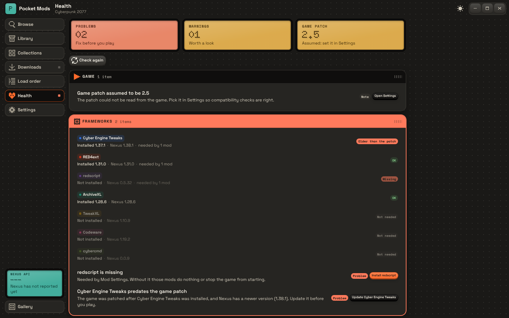

# Milestone 5: Cyberpunk layer



## Summary

- **Game detection** (Settings, Find): Steam (registry, every library in `libraryfolders.vdf`, `appmanifest_1091500.acf`), GOG (Galaxy registry key for product 1423049311), Epic (launcher manifests, best effort). Each result says whether `bin\x64\Cyberpunk2077.exe` is there.
- **Versions**: read from the PE version resource of `Cyberpunk2077.exe` and of each framework's main file (`RED4ext.dll`, `ArchiveXL.dll`, `TweakXL.dll`, `Codeware.dll`, `cyber_engine_tweaks.asi`, `cybercmd.asi`, redscript's `scc.exe`). The game patch is taken from the product version when it reads like "2.31"; otherwise it is picked in Settings (and the health panel says it is assumed).
- **Framework checks** (patches break them):
  - a framework needed by an enabled mod (from its files, its Nexus requirement links, or another framework's needs) and not in the game → problem, fix "Install X";
  - a framework file older than the game's executable (the game was patched after it was installed) → problem when Nexus has a newer version, warning otherwise, fix "Update X";
  - an installed framework whose version is behind Nexus's → warning, fix "Update X";
  - newest framework versions come from one anonymous `legacyModsByDomain` request, cached for an hour.
- **Health panel**: modules for Game, Frameworks, Files in the game, REDmod and Overrides. A module's band turns red when it holds a problem. LCDs count problems (red), warnings (amber) and show the patch. The most serious fixable issue has the screen's one orange key; other fixes are dark keys. The rail's Health key shows a red LED while there are problems. Also checked: deployed files missing or changed outside the app (fix: deploy again), enabled mods not deployed (fix: open Library), the game folder not writable, the REDmod tool missing.
- **REDmod deploy** (`tools\redmod\bin\redMod.exe deploy`), run from Load order or as a Health fix, with the active profile's REDmods in load order; its errors are turned into plain sentences (blocked writes, scripts that do not compile, broken `info.json`, missing files) and the log is shown. The app tracks when it last ran and warns when REDmods were added, removed or reordered since.
- **Profiles**: named sets of enabled mods. "Copy active" makes a new one; Switch undeploys what the new profile turns off and deploys what it turns on, so the game folder always matches the active profile. Each mod has an on/off switch.
- **Load order**: up and down keys per mod in the active profile; the REDmod deploy uses this order.
- **Update checks**: installed mods are compared with Nexus (versions and update times, 50 mods per request, ignored mods skipped) a few seconds after start and every six hours. Library shows "Update x.y" with an Update key, and the rail's Library key a count.

## Run and test (Windows)

```
npm run tauri dev
cargo test -p pocket-core        # 66 tests
```

1. Settings, Find: your Steam or GOG install is listed. Use it. "Read from the game" shows the patch if the executable says it; otherwise pick it.
2. Health: with ArchiveXL installed but RED4ext removed, Frameworks turns red with "RED4ext is missing" and an orange "Install RED4ext" that queues it.
3. Touch the game's exe (or patch the game) so it is newer than RED4ext's DLL: "RED4ext predates the game patch".
4. Delete a deployed mod file by hand: "N files missing or changed", fix "Deploy again".
5. Install a REDmod: Health warns "REDmods need deploying". Run it from Load order; the LCD shows OK or the problems in plain words.
6. Load order: make a profile with "Copy active", turn a mod off, Switch. The mod's files leave the game; switching back brings them back.

## Checked here

- Unit tests: Steam `libraryfolders.vdf` and `.acf` parsing, a Steam layout on disk, Epic manifests, version resources read from a real PE file (`tests/fixtures/version-fixture.dll`, built from `version-fixture.rc` with MinGW), framework detection in a fake game folder, health issues for missing frameworks, the REDmod tool, staged mods and updates, REDmod argument order and error wording, profile switching with real hard links.
- Live: the framework IDs and `legacyModsByDomain` versions (milestone 2's probe).
- Screens in a browser with the demo backend.

## Not verified

- **REDmod's command line** (`deploy -root=… -mod=…` in order) is from memory of CD PROJEKT RED's docs; check it with `redMod.exe deploy -help`. Its error lines are guessed from that tool's style.
- How `Cyberpunk2077.exe`'s version maps to patch numbers (2.3, 2.31 …). If the product version is not written as a patch number, the Settings choice is used.
- Registry keys and default paths for Steam, GOG and Epic on a real machine.
- Framework file locations (`frameworks.rs`), and that their DLLs carry version resources (`version` shows "unknown" if not).
- "Older than the game's executable" uses file modification times; a reinstall or file copy that resets times can give a false alarm or miss one.
