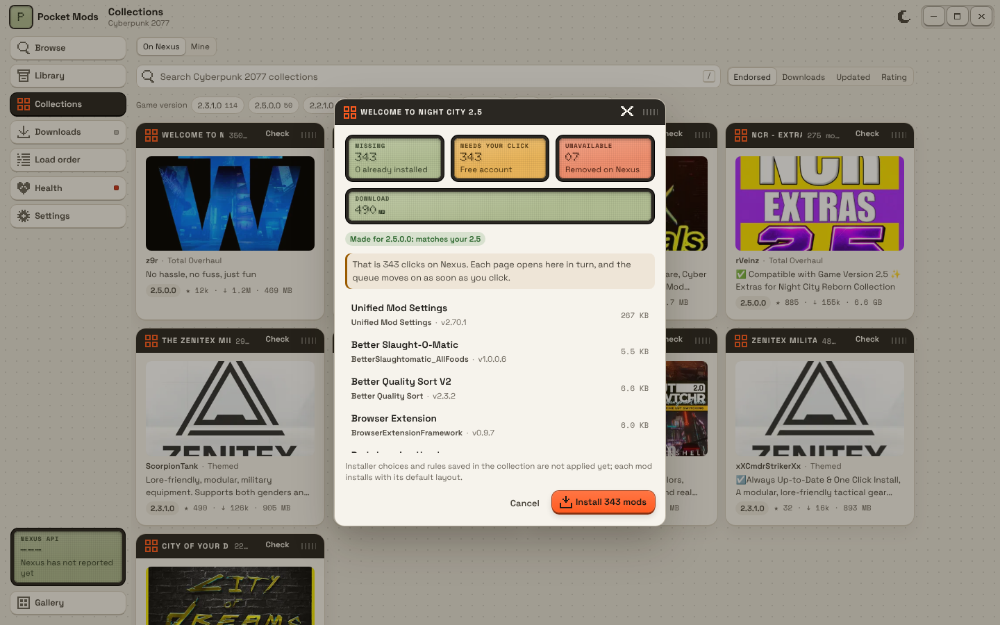

# Milestone 6: Collections



## Summary

- **Browse Nexus collections** (`collectionsV2`, anonymous): search by name, sort by endorsements, downloads, updated or rating, filter by game version with counts from the same response, paging. Cards are modules with the tile image, author, category, game version, endorsements, downloads and size.
- **Pre-install checks** for a collection's latest revision (`collectionRevision`):
  - game version: the revision's versions compared with the installed patch. "2.5.0.0" matches 2.5; executable-style versions ("3.0.80.51928", seen live) are reported as "cannot compare";
  - what is missing, already installed, or installed as another file of the same mod;
  - files that are ARCHIVED or REMOVED on Nexus: the mod's current main file is used instead when there is one ("file gone: using v…"), otherwise the mod is listed as unavailable and skipped;
  - how many clicks it will take (every missing mod on a free account; only manual-only files on Premium) and the download size, on LCDs.
- **Install** queues the missing files (pinned or replacement), optional ones only if asked, and the queue from milestone 4 does the rest.
- **Local collections**: "Make it" builds one from the active profile's enabled Nexus mods. The file (`.pmcollection.json`, format `pocket-mods.collection` v1) pins each mod's **mod ID, file ID, archive MD5, size**, the **dependency graph** (`requires`: the mod IDs each one needs, from requirement links, limited to mods in the collection and frameworks) and the load order. Export saves it; Import opens one, validates it (format, version, game), checks it like a Nexus collection (including whether each pinned file is still on Nexus) and installs requirements before the mods that need them.
- **Publishing to Nexus** is an experiment behind a switch that is off by default, and it does nothing yet: Nexus has not confirmed that third-party apps may publish collections.
- Found while doing this: file `uri` values in collections can be storage paths with no extension (`4c/ec/e3/4cece3d6-…`). The queue now treats those as archives (checked by content when installed) and names the download `<mod>-<file>-<id>`.

## Run and test

```
npm run tauri dev
cargo test -p pocket-core collections
cargo test -p pocket-core --test live -- --ignored     # live browse, revision and check of the top collection
```

1. Collections, On Nexus: the most endorsed Cyberpunk collections show. Pick a game version chip; the list narrows and counts show on the chips.
2. Check on a collection: LCDs for missing, clicks, unavailable and size, and whether its game version matches yours. Install queues them; Downloads takes over.
3. Mine: with some Nexus mods installed, name a collection and press Make it: each mod with its file ID and hash. Export, then Import the same file: everything shows as installed.
4. Remove a mod, import again: only that mod is missing, and its requirements come first in the queue.

## Checked here

- Live (anonymous): browse with the game-version facet, the top collection's revision (350 files, 7 archived), and the check against an empty library.
- Unit tests: install order from the dependency graph, export and import round trip with validation, game version matching, click counts for free and Premium, archived files without a replacement left out, a revision parsed from live JSON.
- Screens in a browser with demo data recorded from the live API.

## Not verified

- **Installer choices and rules** stored in a collection's `collection.json` (FOMOD options, file overrides, load-order rules) are not read or applied. Each mod installs with its default layout. That file comes from the revision's `downloadLink`, which was not tried.
- Whether ARCHIVED and OLD_VERSION files can still be downloaded through `download_link.json`; OLD_VERSION files are used as pinned, ARCHIVED ones are replaced.
- MD5 checks after download for files pinned in a local collection: the hash is stored and shown, but a mismatch is not yet reported in the queue.
- Collection revisions with `updatePolicy` other than "exact" (all 350 seen were "exact").
