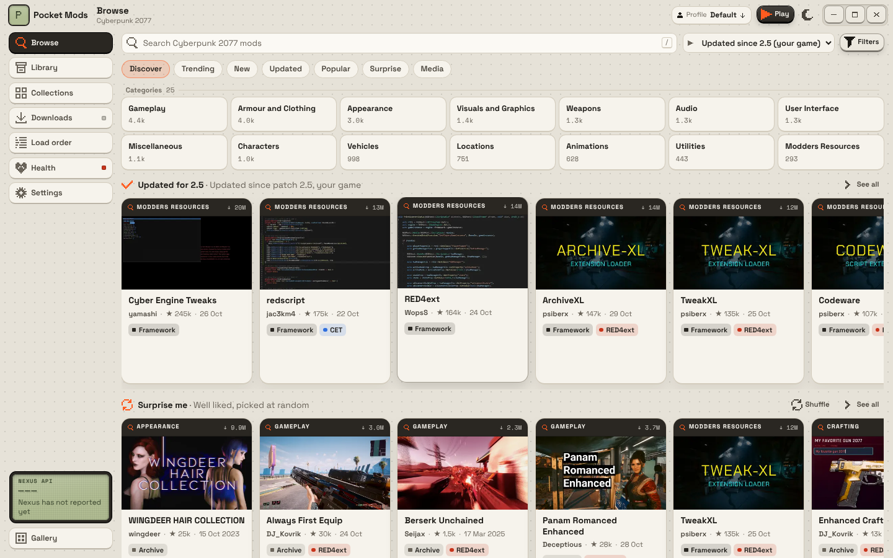
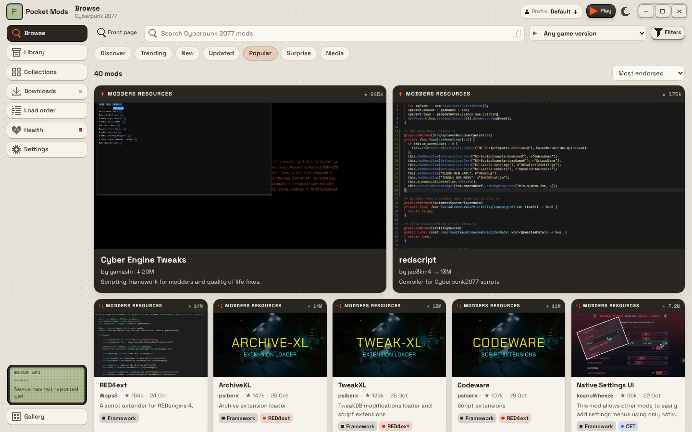
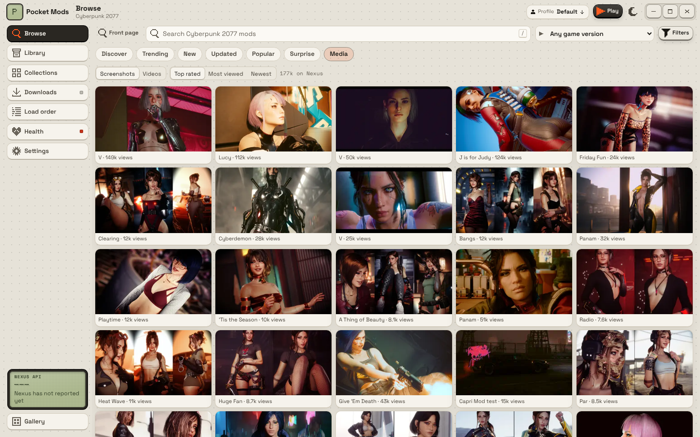
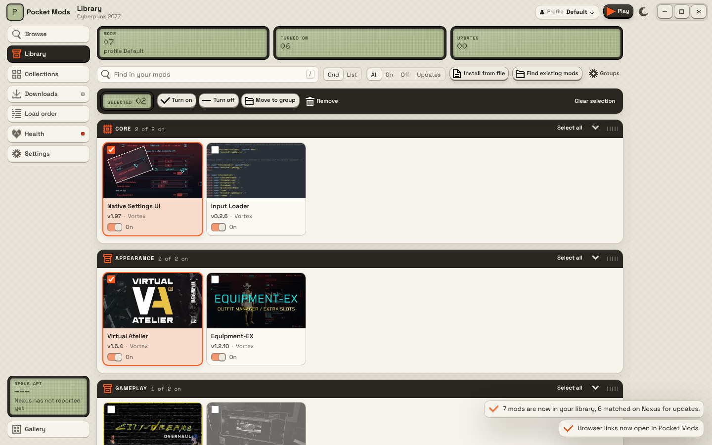
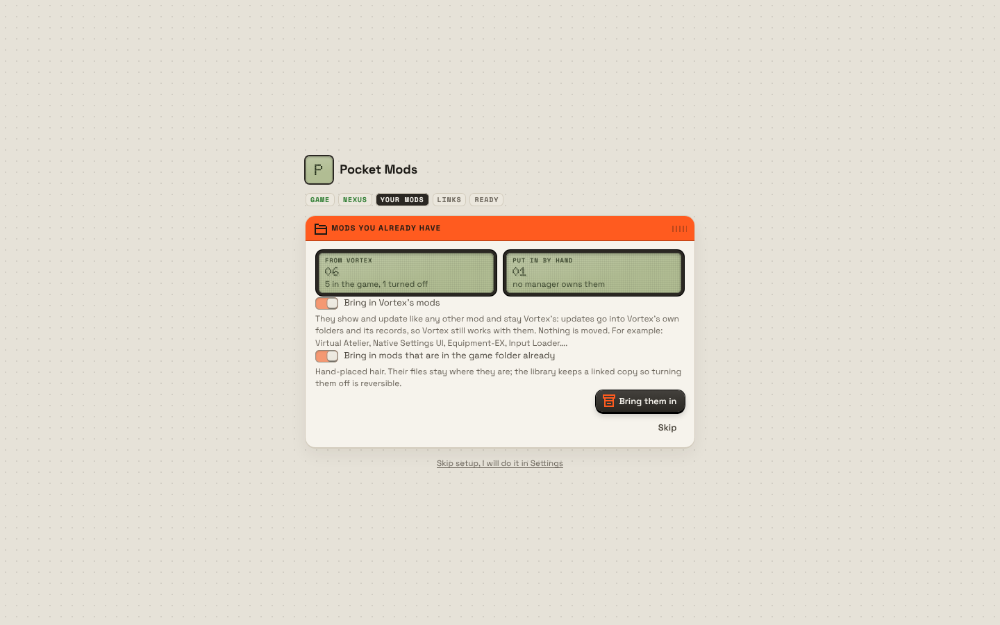

# Round 2: discovery, Vortex compatibility, mass management, and Vortex's pain points

| Discover | Popular | Media |
|---|---|---|
|  |  |  |

| Library (grid, two selected) | Onboarding |
|---|---|
|  |  |

## How browsing gets its data

Browse asks Nexus's official API directly. It needs no account and no visit to the website: someone who has never been to nexusmods.com sees the same mods. A local database keeps recent answers (pages 10 minutes, counts 30 minutes, a mod's detail until Nexus says it changed), so the first visit is live and later ones are instant. With no network, recently seen pages still show; otherwise Browse says it cannot reach Nexus.

## What is new

**Browse, built for discovery**
- A front page of shelves: Trending (new in Nexus's 7-day trending window, most endorsed), Updated for your patch, Best of last month, Surprise me (random, well liked, reshuffle), Hidden gems (many endorsements, few downloads), All-time favourites, Just released, Frameworks and essentials; plus category tiles with counts.
- View tabs: Discover, Trending, New, Updated, Popular, Surprise, Media. Trending and Popular open with two large hero cards, like the Nexus front page.
- Results are a grid of cards (picture, name, author, endorsements, date, type and framework tags). Active filters show as removable chips; the full filter set is a drawer. "Show more" loads the next page in place.
- The game-version filter is a dropdown of every patch, starting on your game's ("Updated since 2.5 (your game)"), or "Any game version".
- A mod opens in a drawer: a gallery of the screenshots and YouTube videos in its description (viewer with arrow keys), and **console commands** found in the description (`Game.AddToInventory(...)` and every other `Game.*` call, plus bare `Items.` IDs turned into `Game.AddToInventory` lines) in a dropdown at the top, each with Copy and Copy all.
- **Media**: the game's top-rated, most-viewed or newest screenshots and videos on Nexus, with the same viewer.
- **Mod of the Month**: Nexus has no field or tag for it (checked: tags, news), so the shelf is "Best of <last month>" (released last month, most endorsed) and says so.

**Installing**
- Required mods: Settings, Installing, "Add them / Ask me / Leave them out", and "Show what will be installed first". With the plan off and requirements on, Install is one click. The plan dialog has an "Also install the N required mods" switch and "Next time, install straight away".
- **FOMOD installers**: a mod with installer options opens a dialog with each step, group and option (pick one, pick any …), the mod's defaults selected. Choices, condition flags and conditional files are applied, and the picked layout is remembered, so turning the mod off and on reinstalls the same variant. (Vortex users report Vortex installing every variant of Cyberpunk FOMODs.)
- **Play** in the title bar: checks Health and lists problems first, runs the REDmod deploy when REDmods changed, and starts the game with `-modded` when REDmods are installed (without it the game ignores REDmods, another common report).

**Library: mass management**
- Grid view with pictures (default) and list view; search; show all, on, off, or with updates.
- Select any number (pick box, a click on a card, or "Select all" per group) and Turn on, Turn off, Update, Move to group or Remove them together.
- **Update all** (the orange key while updates exist), and Update per mod.
- **Groups**: the app's own (Core, Clothing, Character presets, Appearance, Gameplay, Visuals and places, Weapons and vehicles, Audio, Interface, Other) fill themselves from each mod's Nexus category and type; make your own groups, move mods in one at a time or many at once, rename and delete them. Updates keep a mod's group.
- **Profiles in the title bar**: the active profile is always visible; switch, copy this one, start empty, or manage, from any screen.

**Vortex compatibility (two-way)**
- "Find existing mods" (Library, and onboarding) reads Vortex's deployment manifests (`vortex.deployment*.json`) and staging folder, matches each mod to Nexus by its archive name (`<name>-<modId>-<version>-<time>`, checked against the mod's file list), and tracks them as ordinary mods with update checks.
- They stay Vortex's. An update replaces the files **inside the mod's existing Vortex folder** (same name, so Vortex keeps its record), relinks them into the game, rewrites Vortex's manifest entries for that mod (its other entries and its own fields untouched, backup kept in step), and drops the archive in Vortex's downloads folder. Turning one off or removing it takes it out of the game and Vortex's manifest but never deletes its Vortex folder. A switch in the setting `vortex.keepFormat` turns this off.
- Mods put in the game folder by hand are found too (archives, REDmods, scripts, tweaks, CET mods, RED4ext plugins; known frameworks named and matched to Nexus) and tracked without touching the game: each file gets a second hard link in the library, so they turn off and on like any other mod.

**Onboarding**
- First run: finds the game (and uses it if there is only one), puts the mod library on the same drive, offers the Nexus key (optional, with the key page opened in the app), offers to bring in Vortex's and hand-placed mods, takes the nxm:// handler when no app has it and asks when another manager does, then shows Health. Every step can be skipped.

**Fixes for Vortex's pain points** (from forum reports: wrong folders, FOMODs, REDmods not loading, silent nxm failures, lost or stuck downloads, external-changes nags)
- The download queue is saved and comes back after a restart or crash.
- Interrupted downloads resume from where they stopped (HTTP Range) instead of starting over.
- Test key for the nxm:// handler: sends a test link through Windows and says whether Pocket Mods received it.
- Downloaded archives: size shown, "Delete installed archives", and an option to delete each archive after it installs.
- Health shows files changed outside the app with one fix, rather than a dialog on every deploy.

**For mod authors (Create)**
- Check a mod folder or archive the way players' managers will see it: where each file lands, problems (files with no place, REDmods without info.json, clashing variants, bundled installers) and tips (loose archives, an extra top folder).
- Pack a clean zip laid out by game path.
- Publish a new version of an existing file through Nexus's **Upload API** (open beta): multipart upload, finalise, wait for the scan, add the version (move the old one to Old files, update the mod's version), and add a changelog. A brand-new mod page opens Nexus's upload form in the app.

## Test

1. First start: onboarding finds the game. With Vortex installed, "Mods you already have" shows its mod count; bring them in. Library shows them with a "Vortex" tag, in groups.
2. Vortex compatibility: update one of them in Pocket Mods, then open Vortex. The mod is still there, enabled, with the new files; Vortex shows no "changed on disk" dialog. Disable it in Pocket Mods: Vortex's next deploy puts it back (it is still enabled in Vortex).
3. Library: switch Grid and List; select several and Turn off; Move to group with a new name; Update all.
4. Browse: Trending and Popular hero rows; the patch dropdown; open a mod with commands in its description (search "AddToInventory"); Copy all; open a picture and a video.
5. Install a mod with a FOMOD (many clothing mods have colour options): choose, install, turn it off and on: the same variant comes back.
6. Play with a REDmod installed: the deploy runs, then the game starts with `-modded`.
7. Settings, nxm:// links, Test.
8. Create: check a mod folder, pack it, publish a version to a test file you own.

## Checked here

- 86 core unit tests, including: Vortex manifests read and rewritten in place (Vortex's own fields and other mods' entries kept), tracking, update inside Vortex's folder, disable and re-enable, uninstall leaving Vortex's folder; hand-installed mods found and tracked reversibly; FOMOD parsing (UTF-16), choices, flags and conditional files, a FOMOD install remembered across off and on; the saved queue; a download resumed from a .part through a local server; groups; creator check and pack.
- Live: the random sort, `media` for images and videos, `Game.trendingPeriodDays` = 7, collections, and the existing live tests.
- Vortex's formats were read from Vortex's source; the Upload API from Nexus's own GitHub Action.
- Every screen in a headless browser with demo data recorded from the live API; `cargo check` for Windows.

## Not verified

- A real Vortex install: manifests per mod type (`vortex.deployment.<type>.json`) in Cyberpunk's targets, Vortex's reaction to an in-place update, non-hardlink deployment methods.
- The FOMOD subset on real Cyberpunk FOMODs (step visibility conditions are not evaluated; every step shows).
- The Upload API calls (need an author's key and a test file), the `/cyberpunk2077/mods/add` page URL, and the API key page URL used in onboarding.
- `-modded` surviving a Steam relaunch when the game is started from its executable.
- Matching Vortex folders whose archives were renamed or whose files are gone from Nexus (those are tracked without update checks).
