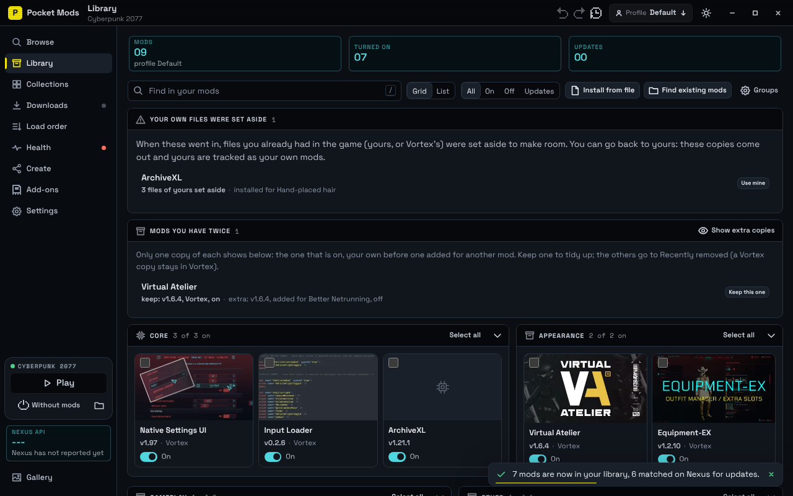
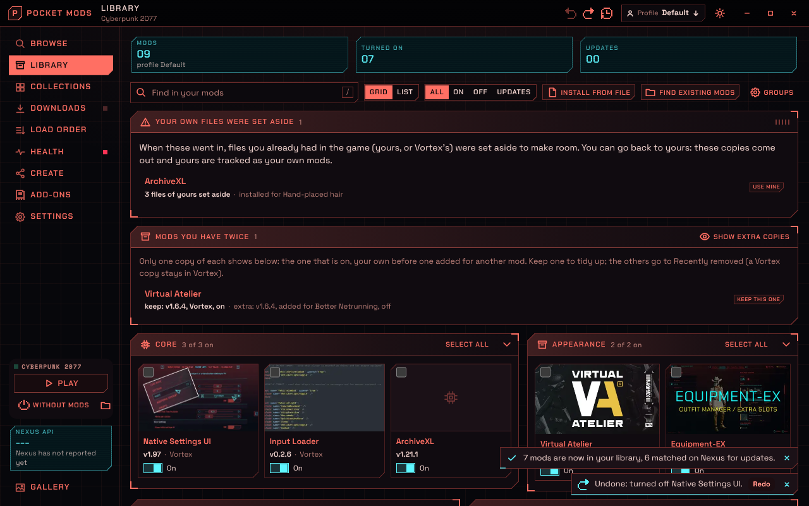
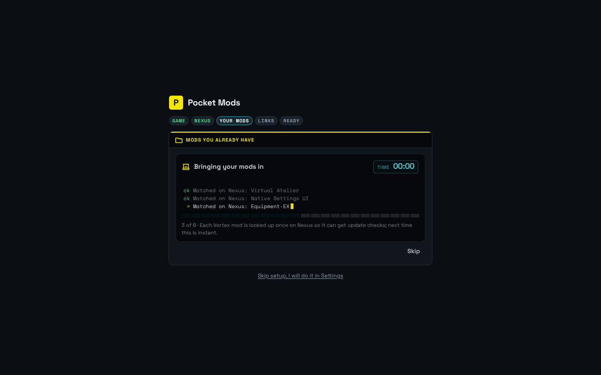
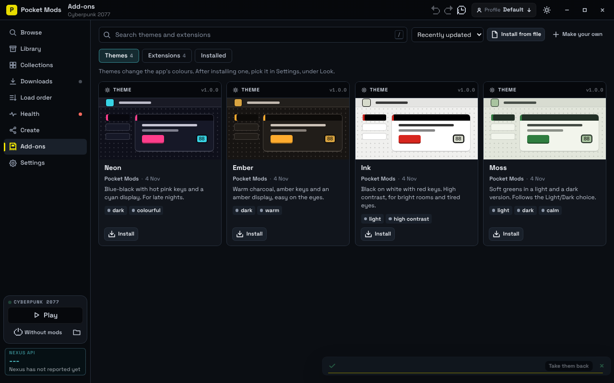
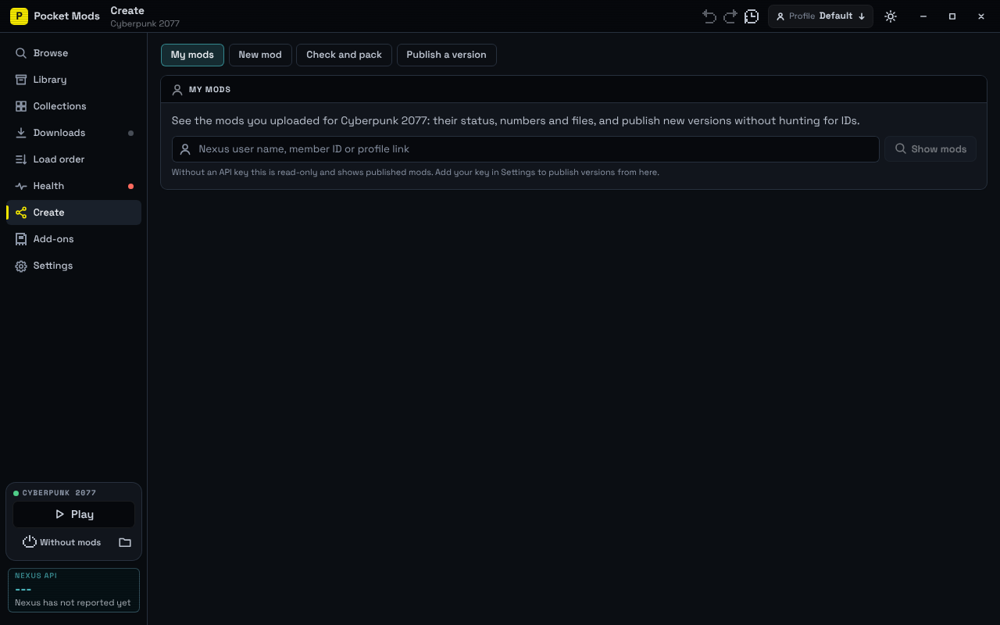

# Round 3: your own mods first, undo everything, themes and add-ons, and production hardening

| Library (Standard, the new default) | Library (Redline) |
|---|---|
|  |  |

| Bringing mods in | Add-ons | Create, My mods |
|---|---|---|
|  |  |  |

## Reported problems, and what changed

**"My versions were buried": duplicate frameworks.** When Pocket Mods installed a requirement you already had
(TweakXL from Vortex, or copied in by hand), it set your files aside and put its own copy in their place, so yours
looked turned off. Now:
- A requirement or a collection item you already have is never downloaded again: installed or tracked mods, frameworks
  found by their files, and mods Vortex has deployed (read from its folder names, no network) all count.
- If it is downloaded anyway (the queue ran before you brought your mods in), the install keeps yours: loose files are
  tracked as your copy of that Nexus mod, a copy from Vortex stays Vortex's, and nothing is replaced.
- For installs from before this change, Library shows **Your own files were set aside** with **Use mine** (the copy
  comes out, your files go back and are tracked as your own), and **Mods you have twice** shows only the copy to keep
  (the one that is on, your own before one added for another mod), with **Keep this one** and **Tidy up all**. This
  also works after you have already imported.

**Blank white API key window.** On Windows a window created from a synchronous Tauri command never finishes loading
(WebView2 needs the main thread the command blocks; it is in Tauri's own docs). Every command that opens the Nexus
window is async now, the window has a dark background while it loads, and Settings has **Get my key**.

**"Looking in the game folder" and "Download links?" showed nothing.** Both now show a scanner: each folder and
Vortex record being read, each Vortex mod as it is matched on Nexus, a segment bar with "3 of 6", and a clock. The links
step says what it reads in the registry, what it found, and what it did.

**Slow the first time, fast from Library.** The paths are one: onboarding and Library both call the same scan and the
same "bring them in". The first run was slow because each Vortex mod was looked up on Nexus with up to three requests
(the mod, then its file contents twice). Matching now makes one request per mod, eight at a time, and caches it, which
is why the second run was (and is) instant.

**Wasted space at full screen.** Library, Collections, Downloads, Health and Load order use the whole window. Small
Library groups sit side by side; Settings and Health flow into columns.

## New

- **Launch deck** at the foot of the rail: **Play** (health check, REDmod deploy, `-modded`), **Without mods** (every
  tracked mod comes out of the game, the game starts, and they all go back when it closes, also after an app restart),
  and the game folder. Extension tools and launch options sit in the menu beside Play.
- **Undo and redo** for turning mods on or off, removing them, moving them between groups, load order and profile
  switches: Ctrl+Z, Ctrl+Y or Ctrl+Shift+Z (not while typing), the keys in the title bar, a History list there, and the
  toast's **Undo**, which turns into **Redo** once used.
- **Recently removed**: removed mods (and the version an update replaced) are kept for 14 days (up to 4 GB) and can be
  put back with their group and on/off state. A Vortex mod's folder is never touched.
- **Themes**: Standard (the new default, dark or light: flat keys, darkened bands, line icons), Redline (styled after the
  game's own HUD), Pocket (unchanged), an optional CRT layer (off, subtle, full: scanlines, vignette, warped glass on the
  title bar and toasts, power-on and channel-change moments), and themes you make in Settings or import. See
  [docs/themes.md](../themes.md).
- **Add-ons**: a marketplace of themes and extensions (this repository's `marketplace/` folder), install from file,
  Share (opens a pre-filled GitHub issue). Extensions add Browse shelves, Library group rules, tools, launch options,
  console commands, links and sandboxed panels; nothing applies until you approve what it asks for. See
  [docs/extensions.md](../extensions.md) and [docs/marketplace.md](../marketplace.md).
- **Create, My mods**: your uploaded mods with their numbers and files, publish a new version of any file without
  hunting for its id, manage pages in the in-app Nexus window, a guided "new mod" flow. See [docs/creators.md](../creators.md).
- Motion and feedback across the app: views, cards and rows settle in, LCDs flicker on change, stepped loaders,
  a shake for refused actions, toasts with a time bar that pause on hover.
- Text size: Ctrl+= and Ctrl+- scale the whole interface, Ctrl+0 resets.
- Drop .zip, .7z or .rar files on the window to install them; a "Manual download" in the Nexus window lands in the
  library and offers Install. Archives named like Nexus downloads are matched to their mod for update checks.
- Endorse and track from a mod's drawer; stop a running download (it resumes on Retry); skip one version of an update.
- **Logs in Health**: RED4ext and its plugins (ArchiveXL, TweakXL, Codeware), redscript and Cyber Engine Tweaks logs from
  the last game start, errors grouped by the mod that owns the file they name, "Turn this mod off" (undoable), Open log,
  and Copy report (a plain-text summary for forums, with personal folders as `%USERPROFILE%`).
- **Overlapping archives in Load order**: the file tables inside `.archive` files are read (header and table only,
  cached), so two mods that change the same game files show as a pair with the winner; "Make X win" renames the
  deployed link with a `!` prefix, as players do by hand, and can be undone. A stray `modlist.txt` is flagged.
- **Change options** after install for mods with installer options (no new download).
- **Take them over is remembered**: a clash decision stays on profile switches and redeploys; Load order lists your
  choices with Forget.
- **Move the library** to another folder or drive from Settings, with every stored path rewritten and the game's
  links checked; moving the game folder re-links the mods.

## Fixed from the complaint audit

A research pass collected 99 recurring complaints about Vortex, the Nexus Mods app and the site, and checked each against
this code. Fixed this round:
- **Downloads over 60 seconds failed** (the shared HTTP client's overall timeout). Downloads have no overall limit now,
  only a stalled connection ends one; a dropped connection resumes up to five times; a finished part is accepted
  (HTTP 416); a retry keeps a still-valid Nexus link, so no new click.
- **Updates switched variants and optional files evicted the main one.** Updates follow the installed file's line
  (2K stays 2K, by name without version numbers); installing an optional file leaves the main one.
- **False "update available".** The check compares each installed file with its own newer copy, not the mod page's
  version, so a page edit, a new optional file or a variant is not an update.
- The window froze while big installs ran: database commands no longer run on the UI thread.
- cybercmd is not asked for with RED4ext 1.13+ (the modding wiki says to remove it); Health says so.
- Compiled scripts left by a removed redscript are reset (Health fix, and automatically when redscript is removed).
- A file changed in place is never deleted on redeploy; a game file a patch rewrote replaces its older backup.
- Mods do not change while the game runs; an install waits for it to close.
- Archives with several variants side by side ask which to install (the FOMOD dialog with one choice) instead of
  installing all of them.
- A profile switch carries on past one failing mod instead of stopping half switched.
- Audioware's files stay in `r6/audioware`; leftovers of a crashed extraction are cleaned at start.
- Collections list items hosted outside Nexus instead of dropping them.
- Health warns when enabled mods need Phantom Liberty and it is not installed.
- The app notices when another manager took the browser's download links and offers to take them back.
- A copy of the app database is kept each day (the last five); a database made by a newer version is refused.

The audit with every source is kept with the session notes, not in the repository.

## Test

1. Start fresh: Standard dark. Onboarding shows what it scans; with Vortex installed, "Bring them in" shows each mod
   being matched.
2. With a framework you already have (for example TweakXL copied in by hand), install a mod that requires it: the queue
   says "You already have TweakXL. Kept yours." and nothing is replaced.
3. Library: turn a mod off, press Ctrl+Z (it comes back on, the toast says Redo), Ctrl+Y. Remove a mod, open Recently
   removed, Put back.
4. Without mods: the game starts vanilla; close it and the mods come back (toast).
5. Settings, Look: switch themes, effects, make a theme. Add-ons: install a theme and an extension, approve it, see its
   shelf in Browse and its tools in the Play menu.
6. Maximise the window: Library groups and Settings use the width.

## Not verified (needs Windows, a real game folder or an author's key)

- The blank-window fix in WebView2 (the cause and fix are documented by Tauri; the window itself was not opened here).
- The Nexus API key page address (`next.nexusmods.com/settings/api-keys`): the site refuses automated checks.
- Without mods: the game-running check (`tasklist`) and the watcher; the Steam copy started from its executable.
- Drag and drop and "Manual download" capture in WebView2.
- Extension panels in WebView2 (`http://pmext.localhost`), opening the browser with `rundll32`, `.exe` tools.
- The CRT layer's warped glass and view transitions in WebView2.
- Every Upload API call (needs an author's key).
- The log parsers against real logs (they follow each tool's source and the modding wiki), the archive reader on real
  mod archives, where archives a `modlist.txt` does not name load, and moving the library while files are in use.
